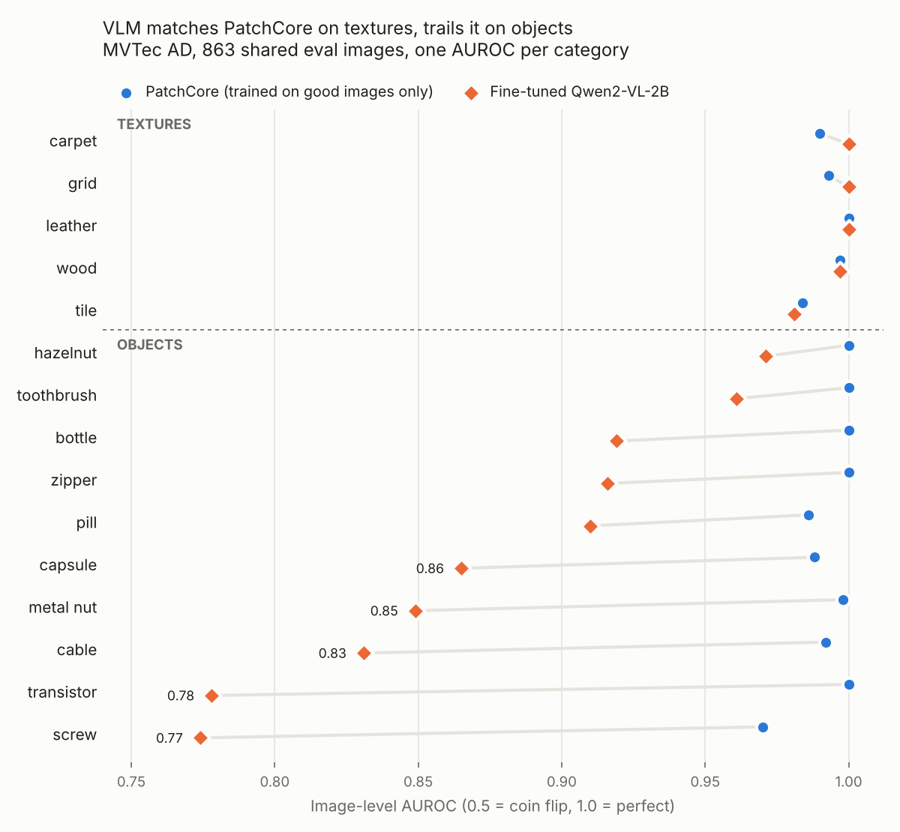

# VLM Defect Inspection

Fine-tuning a small vision-language model (Qwen2-VL-2B, QLoRA) to inspect industrial parts on the MVTec AD dataset, and benchmarking it honestly against PatchCore, a strong anomaly-detection baseline.

The goal is not to beat PatchCore at detection. It is to test whether a small VLM can add something PatchCore cannot - a named defect type and a plain-language location - and what that costs in detection quality.

## Headline result

On 863 shared eval images, the fine-tuned VLM **matches PatchCore on textures (AUROC 0.996 vs 0.993) but trails it on objects (0.877 vs 0.993)**, while also naming the defect type (42% correct) and its location (31% correct), which PatchCore cannot do.



| Mean of per-category scores | PatchCore AUROC | VLM AUROC | VLM F1 | VLM defect-type acc | VLM location acc |
|---|---|---|---|---|---|
| All 15 categories | **0.993** | 0.917 | 0.786 | 0.421 | 0.312 |
| Objects (10) | **0.993** | 0.877 | 0.693 | 0.343 | 0.242 |
| Textures (5) | 0.993 | **0.996** | 0.972 | 0.576 | 0.453 |

Full per-category numbers: [`results/scorecard.csv`](results/scorecard.csv).

## Status

| Week | Focus | Status |
|---|---|---|
| 1 | Data exploration + leakage-safe split | Done |
| 2 | VLM fine-tuning (QLoRA + Unsloth, 1x T4) | Done |
| 3 | Evaluation vs PatchCore | Done |
| 4 | Quantization (16-bit / 8-bit / 4-bit) + FastAPI service | Done |

## What I found

1. **Textures are solved, objects are not.** The VLM reaches 1.000 AUROC on carpet, grid and leather, but drops to 0.77-0.83 on screw, transistor and cable - objects whose defects live in fine shape details (threads, legs, wires).
2. **A Week 1 prediction was half right.** I predicted screw and grid would be hardest (tiny defects + grayscale images). Screw is the VLM's worst category (AUROC 0.774, defect type correct only 3% of the time). Grid is one of its best (1.000). Small size plus no colour did not predict failure on textures.
3. **The VLM's score is useful; its yes/no answer is not.** 72.7% of eval images are defective, so "always defective" scores F1 0.84. The VLM's own yes/no answer scores F1 0.79 overall - below that trivial baseline - and 0.69 on objects. Its ranking score (AUROC 0.917) is where the signal is.
4. **No memorisation - underfitting instead.** Training loss fell to ~0.013, which looked like overfitting. But on 100 of its own training images the VLM is only 73% correct on defective-or-not (vs 76% on eval). It has not fully learned the hard part even on data it saw. Most of each answer is fixed JSON text, which is easy to predict and drove the loss down.

## Week 4: quantization and the API

The same fine-tuned model, loaded three ways, on the same 150 eval images (10 per category) on one Tesla T4:

| Precision | GPU memory (load / peak) | Median time per image | AUROC* | Defective acc | Type acc |
|---|---|---|---|---|---|
| **4-bit** (NF4) | **1.67 / 2.02 GB** | 2.8 s | 0.890 | 0.760 | 0.390 |
| 8-bit | 3.24 / 3.35 GB | 5.1 s | 0.870 | 0.727 | 0.343 |
| **16-bit** (FP16) | 4.54 / 4.66 GB | **2.0 s** | 0.875 | 0.727 | 0.371 |

*Subset AUROC, for comparing the rows with each other, not with the main scorecard. Raw numbers: [`results/quantization.csv`](results/quantization.csv).

- **4-bit cuts peak memory by ~57% versus 16-bit but is ~38% slower** (weights are de-quantized on every pass).
- **16-bit is fastest and fits a T4 comfortably**, so it is the serving choice here. 4-bit is the choice for smaller or shared GPUs.
- **8-bit is the worst of both** - double 4-bit's memory and the slowest. Not worth using.
- **Accuracy is unchanged within noise** (differences of 0.01-0.04 on ~10 images per category).

**The API** (`src/defect_vlm/api.py`, FastAPI): `GET /health`, `GET /categories`, `POST /inspect` (a photo + its category) returns JSON with `defective`, `defect_type`, `location`, `score` and `latency_ms`. Tested two ways: 7 unit tests with a fake model (run on a laptop, no GPU), and live against the real 4-bit model on Kaggle, where 5 eval photos each returned valid JSON in ~2.5 s and an unknown category returned a clean 400 error.

```
POST /inspect   category=capsule, image=crack.png
-> {"category": "capsule", "defective": true, "defect_type": "crack", "location": "center",
    "score": 0.8706, "valid_json": true, "latency_ms": 2561.8}
```

Run it on a GPU machine:
```
pip install unsloth fastapi uvicorn python-multipart
export ADAPTER_DIR=/path/to/qwen2vl-mvtec-lora   # from the mvtec-finetune Kaggle output
export QUANT=16bit                               # or 4bit for small GPUs
PYTHONPATH=src uvicorn defect_vlm.api:app
```

## How it works

- **Data:** MVTec AD, 5354 images, 15 categories. The train split has 0 defective images, so the VLM's defect examples have to come from the test split.
- **Split:** the test set is split 50/50, stratified by `category/defect_type` (seed 42). Neither model ever trains on the `eval` half. Enforced by `check_split()` and unit tests.

| Role | Images | Used for |
|---|---|---|
| `train_good` | 3629 | PatchCore memory bank; extra good examples for the VLM |
| `vlm_train` | 862 | VLM fine-tuning only |
| `eval` | 863 | Scoring both models |

- **VLM:** Qwen2-VL-2B (4-bit) with LoRA adapters (r=16), trained with Unsloth on 1267 examples (631 defect, 636 good), images resized to 448x448. It answers `{"defective": ..., "defect_type": ..., "location": ...}`; location is a 3x3 grid cell derived from each defect's mask. One epoch took **18 minutes on one Tesla T4**, peak GPU memory 2.4 GB. The AUROC score is the model's probability of answering `true`.
- **PatchCore:** WideResNet-50 layer 2+3 features, per-category memory bank from good images only, 10% greedy coreset, image score = max nearest-neighbour patch distance.

## Limitations

- **Not a like-for-like contest.** The VLM trained on 631 labelled defect images; PatchCore saw none. Matching PatchCore is less impressive than it sounds.
- **Half the published test set.** Both models are scored on our 863-image eval half, so numbers are not directly comparable to published leaderboards.
- **Simplified PatchCore** (no score re-weighting). It still reaches 0.993 mean AUROC, in line with the paper's ~0.99.
- **Small categories are noisy.** Toothbrush (15 eval defects) and transistor (20) move ~5-7 points per image. Rare defect types have only 4-5 eval images, so per-type scores are not reported.
- **F1-max for PatchCore uses a threshold chosen on eval** (standard practice, but optimistic). The VLM's F1 uses its own yes/no answer with no tuning.

## Next steps

- Serving: try AWQ-INT4 with vLLM (the original plan) for batched, faster inference; this project used bitsandbytes through Unsloth because it is the same, proven path as training on a T4.
- To close the object gap: higher input resolution or crops around the part, more epochs, and a confidence-gated second look at uncertain images.

## Repository layout

```
src/defect_vlm/split.py              leakage-safe split + checks
src/defect_vlm/inference.py          loads the model, inspects one image
src/defect_vlm/api.py                FastAPI service
tests/                               unit tests (pytest)
notebooks/01_mvtec_exploration.ipynb dataset exploration
notebooks/02_split.ipynb             creates splits.csv
notebooks/03_finetune.ipynb          QLoRA fine-tuning (Kaggle T4)
notebooks/04_eval_vlm.ipynb          scores the VLM on the eval set
notebooks/05_patchcore.ipynb         PatchCore baseline on the same images
notebooks/06_compare.ipynb           scorecard and chart
notebooks/07_quantize_and_api.ipynb  quantization benchmark + live API demo
results/                             scorecard.csv, auroc_by_category.png, quantization.csv
```

The notebooks run on Kaggle. Run outputs are visible in the public Kaggle versions:
- [01 Exploration](https://www.kaggle.com/code/yashaswinimjv/mvtec-ad-exploration) - dataset questions Q1-Q5
- [02 Split](https://www.kaggle.com/code/yashaswinimjv/mvtec-split) - creates splits.csv, leakage checks
- [03 Fine-tune](https://www.kaggle.com/code/yashaswinimjv/mvtec-finetune) - training loss, before/after answers
- [04 VLM evaluation](https://www.kaggle.com/code/yashaswinimjv/mvtec-eval-vlm) - VLM predictions on 863 eval images
- [05 PatchCore](https://www.kaggle.com/code/yashaswinimjv/mvtec-patchcore) - PatchCore scores on the same images
- [06 Compare](https://www.kaggle.com/code/yashaswinimjv/mvtec-compare) - scorecard, chart, memorisation check
- [07 Quantization + API](https://www.kaggle.com/code/yashaswinimjv/mvtec-quantize-api) - memory/speed/accuracy per precision, live API calls

## Run the tests

```
python -m venv .venv
.venv\Scripts\activate          # Windows
pip install -r requirements.txt
pytest -q
```

## Dataset and license

MVTec AD (Bergmann et al., CVPR 2019), released under CC BY-NC-SA 4.0. PatchCore: Roth et al., CVPR 2022. This is a non-commercial portfolio project.
